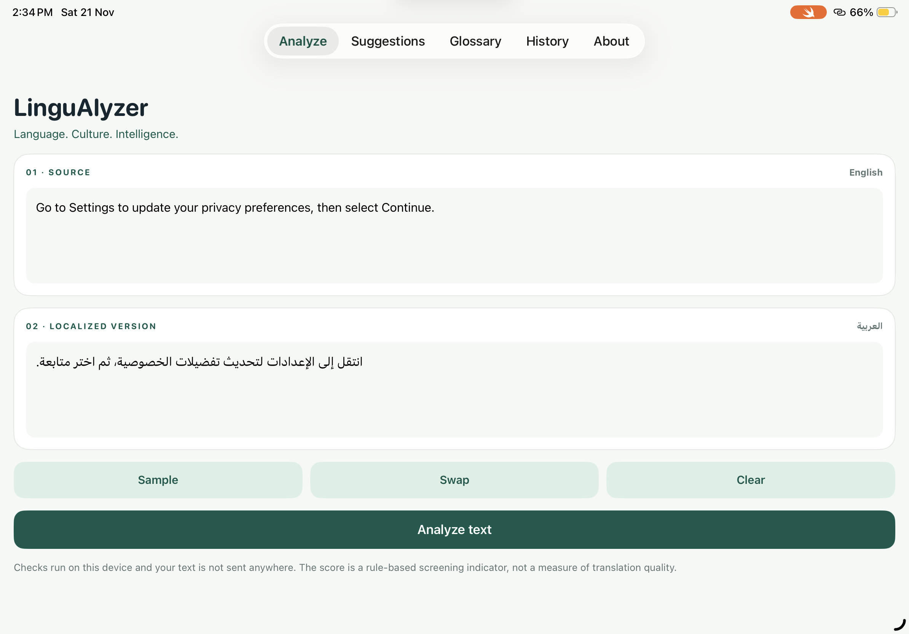
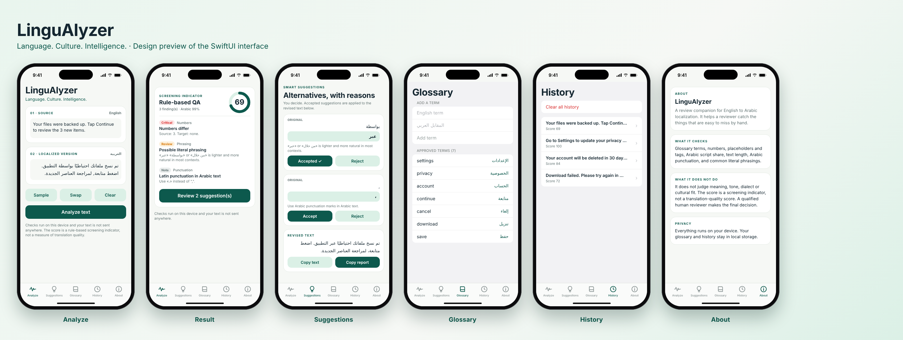
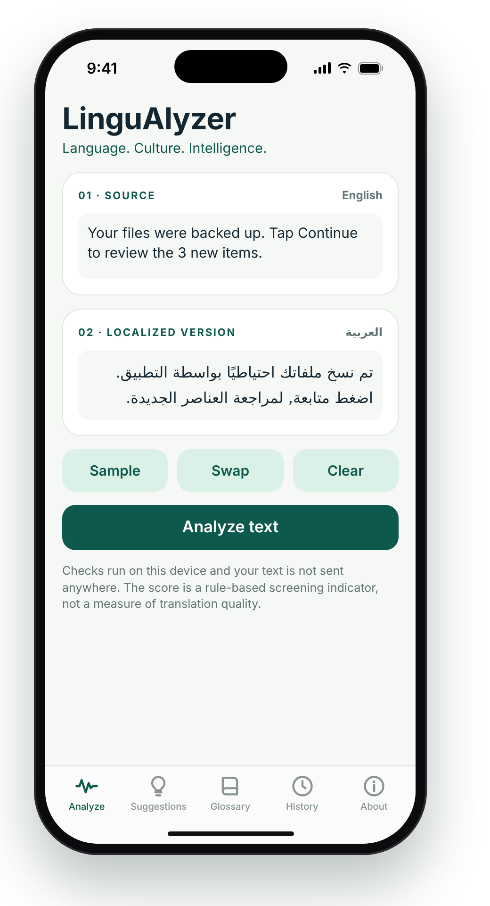
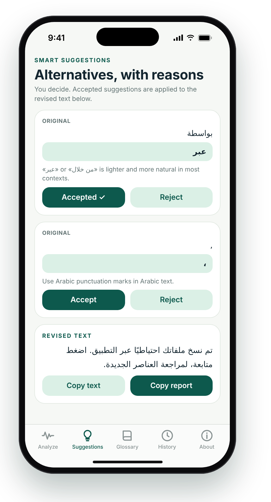
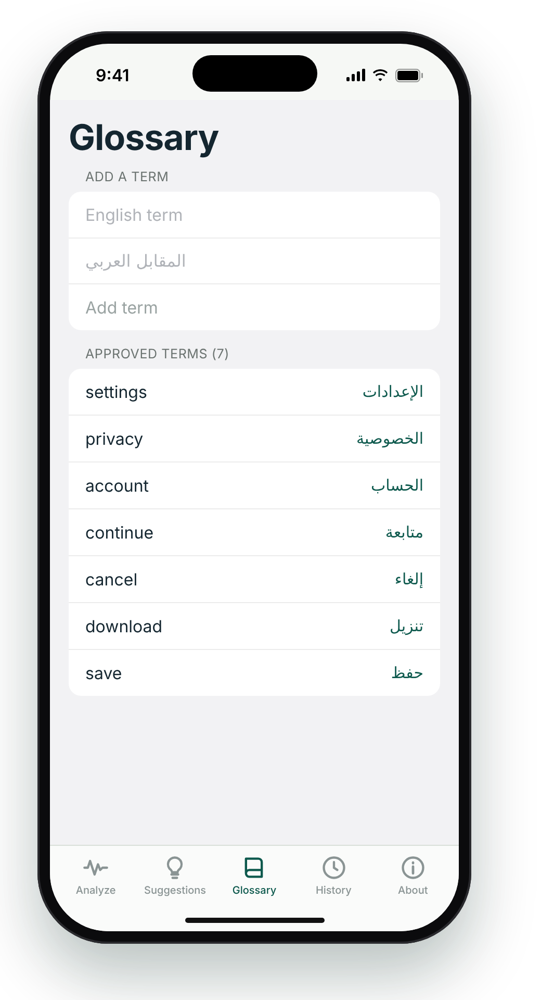
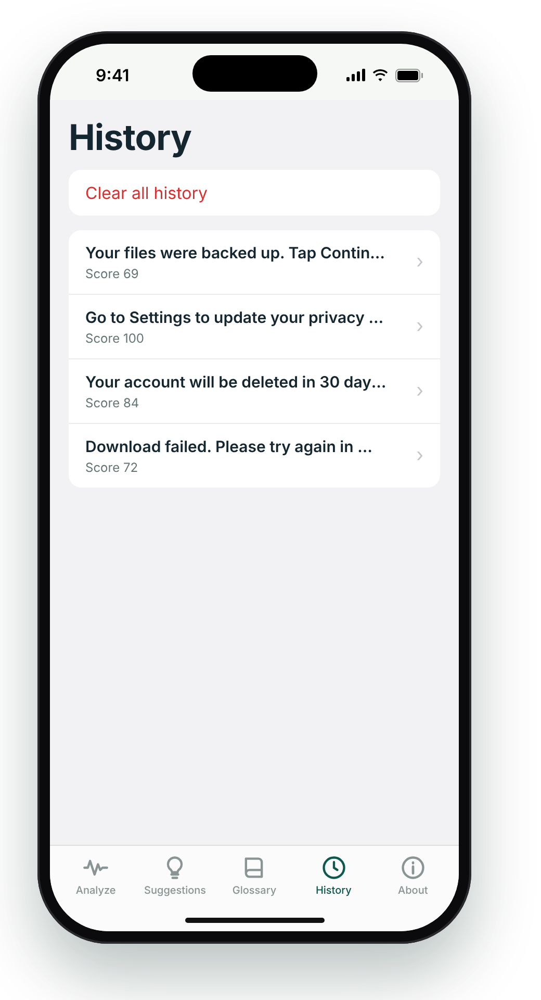
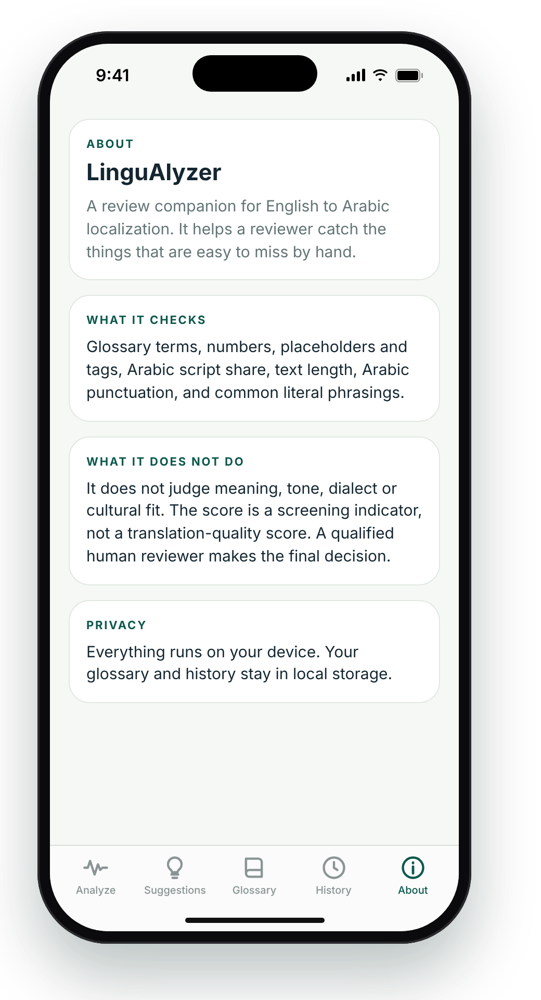

<div align="center">

<a href="Assets/AppIcon-1024.png"></a>

# LinguAlyzer

**Language. Culture. Intelligence.**

A review companion for English → Arabic localization, built for iPhone and iPad with SwiftUI.


[Live web version](https://lingualyzer-j46qnmpej563zcfh79exbv.streamlit.app) ·
[Python project](https://github.com/ShahadA-lmutairi/LinguAlyzer) ·
[How the checks work](docs/HOW_IT_WORKS.md) ·
[Design notes](docs/DESIGN.md) ·
[**UX/UI case study**](https://shahada-lmutairi.github.io/LinguAlyzer-iOS/) ·
[Figma design](https://www.figma.com/design/idQCoNNtCkRK26dG9iidO2)

</div>

---

## Overview

LinguAlyzer checks an Arabic translation against its English source. It catches the mechanical issues that are easy to miss by hand — a changed glossary term, a mismatched number, a missing `{name}` placeholder, a literal word-for-word phrase — and leaves the judgment on meaning, tone, and culture to a human reviewer.

It started as a [Python project](https://github.com/ShahadA-lmutairi/LinguAlyzer) with a [live web version](https://lingualyzer-j46qnmpej563zcfh79exbv.streamlit.app). This repository is the native iOS version.

<div align="center">
  <a href="screenshots/ipad-analyze.png">
    
  </a>
  <br>
  <sub><i>The Analyze screen running on iPad (real device screenshot). Click to open full size.</i></sub>
</div>

## Features

| Check | What it looks for |
|---|---|
| **Terminology** | English glossary terms in the source that are missing their approved Arabic term. Arabic matching uses NLP, so «إعدادات», «بالإعدادات» and «الإعدادات» all count as the same term |
| **Numbers** | Digits that differ between source and target (Arabic-Indic digits are normalized first) |
| **Placeholders** | `{name}`, `%s`, `%1$@` and `<b>` style tokens that don't match |
| **Script** | Share of Arabic letters, to spot text left untranslated |
| **Length** | Target much shorter or longer than the source |
| **Phrasing** | Common literal patterns such as `بواسطة`, `قام بـ`, `يتم` |
| **Punctuation** | Latin `? ; ,` used inside Arabic text |
| **Spacing** | Double spaces |
| **Language** | Detects the target's language with Apple's NaturalLanguage framework and flags text that isn't Arabic |
| **Sentences** | Compares sentence counts between source and target to catch a missing sentence |

### Arabic NLP

The analyzer uses Apple's **NaturalLanguage** framework, on the device, to handle Arabic properly:

- **Tokenization** with `NLTokenizer` (words and sentences).
- **Normalization** for Arabic spelling variants: tashkeel and tatweel removed, alef forms (أ إ آ) unified, taa marbuta and alef maqsura unified, the definite article (ال، بال، وال، لل…) and one attached clitic (و ب ل ف ك) handled.
- **Language identification** with `NLLanguageRecognizer`.

This reduces false alarms in glossary checks, which used to need an exact character match.

Every finding comes with a short reason. For phrasing and punctuation, the reviewer can **accept or reject** each suggested replacement; accepted changes are applied to produce a revised text that can be copied along with a report.

> [!NOTE]
> The score (100 minus penalties) is a **rule-based screening indicator**, not a translation-quality score. It does not judge meaning, tone, dialect, or cultural fit — a qualified human reviewer makes the final decision. All processing happens on the device; no text is sent anywhere.

## Interface

<div align="center">
  <a href="docs/design-preview/00-overview.png">
    
  </a>
</div>

<table>
  <tr>
    <td align="center" width="33%"><a href="docs/design-preview/01-analyze.png"></a><br><b>Analyze</b><br><sub>Paste source and Arabic target, run the checks</sub></td>
    <td align="center" width="33%"><a href="docs/design-preview/02-result.png"></a><br><b>Result</b><br><sub>Screening score and findings with reasons</sub></td>
    <td align="center" width="33%"><a href="docs/design-preview/03-suggestions.png"></a><br><b>Suggestions</b><br><sub>Accept or reject, copy revised text and report</sub></td>
  </tr>
  <tr>
    <td align="center"><a href="docs/design-preview/04-glossary.png"></a><br><b>Glossary</b><br><sub>Add and remove approved English–Arabic terms</sub></td>
    <td align="center"><a href="docs/design-preview/05-history.png"></a><br><b>History</b><br><sub>Past reviews, saved on the device</sub></td>
    <td align="center"><a href="docs/design-preview/06-about.png"></a><br><b>About</b><br><sub>What the app does and does not do</sub></td>
  </tr>
</table>

<sub>These are design previews that follow the SwiftUI code (same colors, layout, and text), not device screenshots. Click any screen to open it full size.</sub>

**UX/UI case study:** the problem, users, design principles, key decisions and iterations behind the app: [read the case study](docs/CASE_STUDY.md) or [view it as a web page](https://shahada-lmutairi.github.io/LinguAlyzer-iOS/).

**Figma:** the full design is available as an editable Figma file, with all six screens, reusable components (buttons, tab bar, finding rows), color variables, and App Store screenshots. [Open in Figma →](https://www.figma.com/design/idQCoNNtCkRK26dG9iidO2)

## Getting started

**Requirements:** iOS / iPadOS 17 or later.

<details open>
<summary><b>Swift Playgrounds (iPad)</b></summary>

1. Create a new **App** playground.
2. Replace the contents of `ContentView.swift` with [`Sources/ContentView.swift`](Sources/ContentView.swift).
3. Leave `MyApp.swift` as it is.
4. In **App Settings**, set the minimum iOS version to 17.
5. Press **Run**.

</details>

<details>
<summary><b>Xcode (Mac)</b></summary>

1. Create a new iOS App project (SwiftUI), minimum deployment target iOS 17.
2. Add [`Sources/ContentView.swift`](Sources/ContentView.swift) and [`Sources/MyApp.swift`](Sources/MyApp.swift), replacing the defaults.
3. Use [`Assets/AppIcon-1024.png`](Assets/AppIcon-1024.png) as the app icon.
4. Run on a simulator or a device.

</details>

## Project structure

```
LinguAlyzer-iOS/
├── Sources/
│   ├── ContentView.swift      Models, Analyzer rules, store, and all screens
│   └── MyApp.swift            App entry point
├── Assets/
│   └── AppIcon-1024.png       App icon (1024 px)
├── docs/
│   ├── HOW_IT_WORKS.md        How each check and the score work
│   ├── DESIGN.md              Colors, type, icon, principles
│   ├── README.pdf             Printable project summary
│   └── design-preview/        Design previews of each screen
└── screenshots/
    └── ipad-analyze.png       Real screenshot from iPad
```

## Project status

- ✅ All screens run on iPad: Analyze, Suggestions, Glossary, History, and About.
- ✅ The Analyze flow works: an earlier crash when pressing *Analyze text* has been fixed.
- ✅ Arabic NLP with Apple's NaturalLanguage framework: term matching, language detection and sentence checks, covered by 12 unit tests.
- ✅ Automated tests run on iPhone and iPad simulators (Swift 5 and 6) on every pull request, including a UI test that taps *Sample*, then *Analyze text*, and checks the result appears.

## Roadmap

- [x] Unit tests for the Arabic NLP and `Analyzer`
- [ ] On-device phrasing classifier trained with Create ML on a hand-annotated Arabic dataset ([`data/phrasing`](data/phrasing), [guidelines](data/phrasing/GUIDELINES.md))
- [ ] On-device rewrite suggestions with Apple's Foundation Models
- [ ] Back-translation check with Apple's Translation framework
- [ ] On-device semantic similarity (Core ML), validated with Arabic reviewers
- [ ] Register and tone checks for formal text
- [ ] Termbase import (TBX / CSV)
- [ ] User testing with professional reviewers

## Author

**Shahad**, applied linguist (M.A. Applied Linguistics) working on Arabic NLP, localization and data, Saudi Arabia.

## License

Released under the [MIT License](LICENSE).
