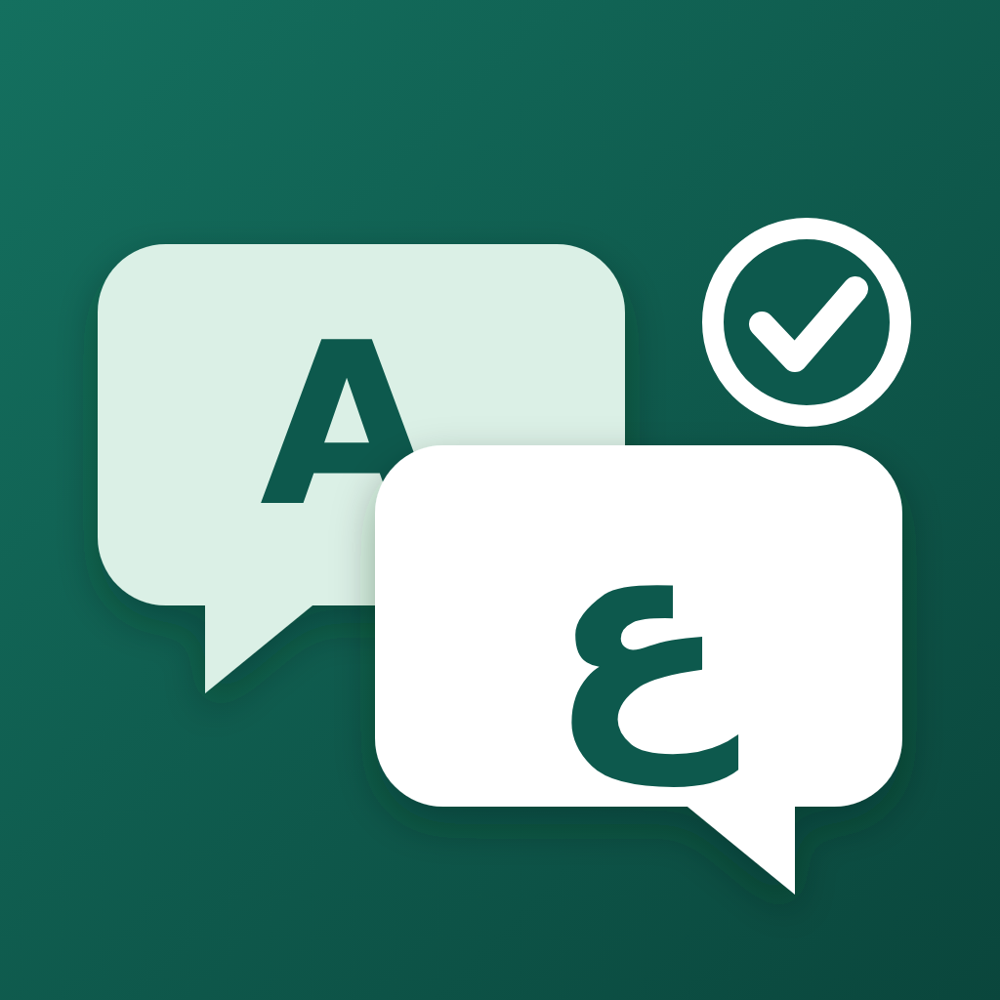

<p align="center">
  
</p>

# LinguAlyzer

**Language. Culture. Intelligence.**

An iOS app (SwiftUI) that helps a reviewer check an Arabic translation against its English source. It catches the things that are easy to miss by hand, and leaves the judgment to a human.

It started as a Python project: <https://github.com/ShahadA-lmutairi/LinguAlyzer>, which has a **live web version** you can try now: <https://lingualyzer-j46qnmpej563zcfh79exbv.streamlit.app>. This repo is the iOS version, built for iPhone and iPad.

<p align="center">
  
</p>

*The Analyze screen, running on my iPad.*

## Why I built it

I study translation and localization. When I review Arabic text, the same small problems show up again and again: a glossary term that was changed, a number that doesn't match, a `{name}` placeholder that disappeared, or a phrase that reads like a word-for-word copy of the English. A tool can catch these in seconds, so the reviewer can spend their time on meaning, tone, and culture.

## What it checks

| Check | What it looks for |
|---|---|
| Terminology | English glossary terms in the source that are missing their approved Arabic term |
| Numbers | Digits that differ between source and target (Arabic-Indic digits are normalized first) |
| Placeholders | `{name}`, `%s`, `%1$@` and `<b>` style tokens that don't match |
| Script | Share of Arabic letters, to spot text left untranslated |
| Length | Target much shorter or longer than the source |
| Phrasing | Common literal patterns such as `بواسطة`, `قام بـ`, `يتم` |
| Punctuation | Latin `? ; ,` used inside Arabic text |
| Spacing | Double spaces |

Each result is shown with a short reason. For phrasing and punctuation, the reviewer can **accept or reject** a suggested replacement, and the accepted ones are applied to produce a revised text.

## Important note

The score (100 minus penalties) is a **rule-based screening indicator**, not a translation-quality score. It does not judge meaning, tone, dialect, or cultural fit. A qualified human reviewer makes the final decision. Everything runs on the device and no text is sent anywhere.

## Interface (design preview)

<p align="center">
  
</p>

These are design previews that follow the SwiftUI code (same colors, layout, and text). They are not screenshots from a device. The real screenshot above is from my iPad.

## Screens

- **Analyze:** paste source and Arabic target, run the checks
- **Suggestions:** accept or reject each suggestion, copy the revised text and a report
- **Glossary:** add and remove approved English-Arabic terms
- **History:** past reviews, saved on the device
- **About:** what the app does and does not do

## Run it

**Swift Playgrounds (iPad), what I use:**
1. Create a new **App** playground.
2. Replace everything in `ContentView.swift` with `Sources/ContentView.swift`.
3. Leave `MyApp.swift` as it is.
4. In App Settings, set the minimum iOS version to 17.
5. Press Run.

**Xcode (Mac):**
1. Create a new iOS App project (SwiftUI), minimum iOS 17.
2. Add `Sources/ContentView.swift` and `Sources/MyApp.swift`, replacing the defaults.
3. Use `Assets/AppIcon-1024.png` as the app icon.
4. Run on a simulator or a device.

## Project status

This is a work in progress, and I want to be upfront about where it stands.

- The interface, navigation, Glossary and About screens run on iPad.
- **Known issue:** in Swift Playgrounds on iPad, the app closes when I press *Analyze text* ("Unknown Crash"). I couldn't read a crash log yet, so I am narrowing it down by removing parts one by one. I haven't tested it on a Mac or in the iOS Simulator.
- The analysis logic itself is plain Swift (`Analyzer` in `ContentView.swift`) and is easy to test separately.

## Structure

```
Sources/
  ContentView.swift   models, Analyzer rules, store, and all screens
  MyApp.swift         app entry point
Assets/               app icon (1024 px)
docs/                 how the checks work, design notes
screenshots/
```

## What I would do next

- Fix the crash and add unit tests for `Analyzer`
- On-device semantic similarity (Core ML), tested with Arabic reviewers
- Register and tone checks for formal text
- Termbase import (TBX / CSV)
- Try it with real reviewers and collect feedback

## Author

Shahad, translation and localization student, Saudi Arabia.
