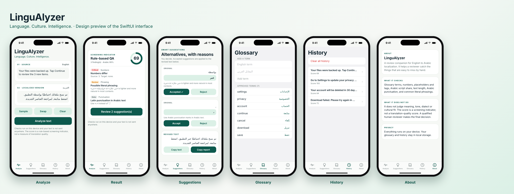
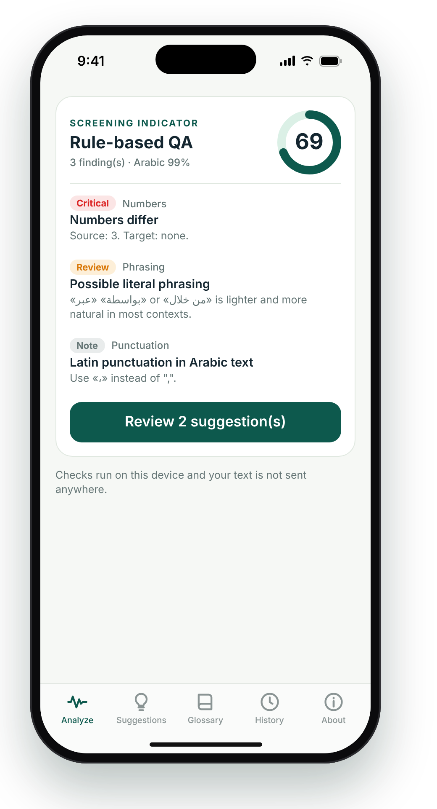
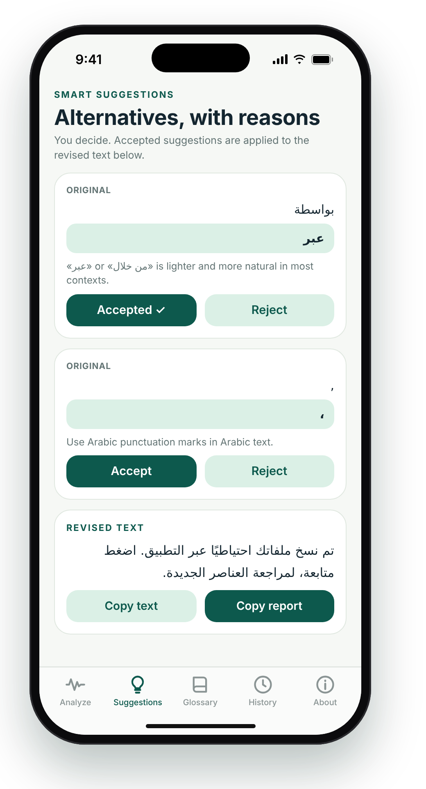

# LinguAlyzer: UX/UI case study

**Designing a review companion for English → Arabic localization**

| | |
|---|---|
| **Role** | Solo project: problem definition, UX/UI design, iOS development |
| **Platform** | iPhone and iPad (SwiftUI), with a companion web app |
| **Tools** | Figma, SwiftUI, Apple NaturalLanguage framework |
| **Links** | [Figma file](https://www.figma.com/design/idQCoNNtCkRK26dG9iidO2) · [Code](https://github.com/ShahadA-lmutairi/LinguAlyzer-iOS) · [Web version](https://github.com/ShahadA-lmutairi/LinguAlyzer) |

  

---

## 1. The problem

Reviewing an Arabic translation is slow, careful work, and most of it is not about meaning. The same small, mechanical problems come back again and again:

- a glossary term that was translated differently from the approved one
- a number that doesn't match the source
- a `{name}` placeholder or `<b>` tag that disappeared
- Latin punctuation (`?` `,`) inside Arabic text
- a sentence that is correct but reads like a word-for-word copy of the English («قام المستخدم بتحديث الإعدادات» instead of «حدّث المستخدم الإعدادات»)

Each one is easy to miss by eye and quick for software to catch. Checking them by hand takes time away from what only a person can judge: meaning, tone and cultural fit. Many general QA tools also treat Arabic as an afterthought: they compare characters exactly, so «إعدادات» and «الإعدادات» look like two different words.

**Design question:** *How might we take the mechanical checks off a reviewer's plate, without taking the judgment away from them?*

## 2. Who it's for

| | |
|---|---|
| **Primary user** | A reviewer checking an English → Arabic translation: a localization QA specialist, an editor, or a translator checking their own work before delivery. |
| **Context** | Short UI strings (buttons, alerts, settings, onboarding), reviewed one at a time or in batches. Often on an iPad or laptop, between other tasks. |
| **What they need** | A fast first pass that points at likely problems, explains *why*, and never makes the final call for them. |
| **What they worry about** | A score that pretends to measure quality; tools that rewrite text silently; client text leaving the device. |

## 3. Design principles

These came first and drove every later decision:

1. **The tool suggests, the reviewer decides.** Nothing is changed without an explicit choice.
2. **Say plainly what the score does and does not mean.** It is a screening indicator, not a translation-quality grade.
3. **Explain every flag.** No finding without a reason.
4. **Arabic is a first-class language**, not a mirror of the English layout.
5. **Keep text on the device.** Translations are often confidential.

## 4. Information architecture

The app follows the reviewer's workflow, one tab per step:

| Tab | Job |
|---|---|
| **Analyze** | Paste source and Arabic target, run the checks, see the result |
| **Suggestions** | Accept or reject each proposed fix, copy the revised text and a report |
| **Glossary** | Maintain approved English → Arabic terms |
| **History** | Return to earlier reviews, saved on the device |
| **About** | What the app checks, what it doesn't, and how privacy works |

Keeping the result on the Analyze screen (instead of a separate page) means the reviewer sees the text and its problems together, and can edit and re-run without navigating.

## 5. Key design decisions

### 5.1 A score that doesn't overclaim

A single number is useful for triage, but dangerous if it reads as "this translation is 69% good". So the result card is labelled **"Screening indicator · Rule-based QA"**, the number sits in a ring rather than a big headline, and a line under the input says it is *not a measure of translation quality*. The About screen repeats this in plain words.

The score is simple and explainable: 100 minus a fixed penalty per finding (Critical 20, Review 8, Note 3), so a reviewer can always see where it came from.

 

### 5.2 Every flag has a severity and a reason

Each finding shows three things, in this order:

1. a **severity badge**: *Critical* (red), *Review* (orange), *Note* (grey), so the eye goes to what matters first
2. a **short title**: "Numbers differ"
3. a **reason or evidence**: "Source: 3. Target: none."

Colour is never the only signal; the badge always carries a word.

### 5.3 Suggestions need an explicit decision

Suggested replacements are never applied automatically. Each card shows the **original**, the **proposed replacement** on a mint background, the **reason**, and two buttons: **Accept** and **Reject**. Only accepted changes are applied to the revised text at the bottom, which the reviewer can then copy along with a report.

Some patterns (like «قام بـ» + noun) can't be fixed by a simple replacement. Instead of guessing, the card says **"Rephrase manually"**, which keeps the tool honest about its limits.

 

### 5.4 Arabic as a first-class language

- Arabic fields are laid out **right-to-left** with right-aligned text, while English fields stay left-to-right on the same screen.
- The Arabic language label is written in Arabic («العربية»).
- Glossary terms are matched through **Arabic normalization**, so «إعدادات», «بالإعدادات» and «الإعدادات» count as the same term (see *Iterations*).
- Arabic-Indic digits (٠-٩) are treated as the same numbers as 0-9.

### 5.5 Privacy as a visible feature

All checks run on the device, including the Arabic NLP (Apple's NaturalLanguage framework). This is stated where the reviewer makes the decision to paste text (under the Analyze button), not only in a settings page.

## 6. Visual design

| Token | Hex | Use |
|---|---|---|
| Forest | `#0D594D` | Primary actions, accents, selected tab |
| Mint | `#DBF0E6` | Secondary actions, accepted replacements |
| Canvas | `#F6F8F5` | Screen background |
| Ink | `#142630` | Main text |
| Muted | `#647575` | Secondary text |
| Line | `#E0E8E0` | Card borders |

- **Calm, editorial palette:** a reviewing tool is used for long stretches; green reads as "checked" without the alarm of red.
- **Cards** group each step (source, target, result) so the screen reads top to bottom like the workflow.
- **Small-caps eyebrows** ("01 · SOURCE", "02 · LOCALIZED VERSION") number the steps.
- **App icon:** two speech bubbles, a Latin **A** and an Arabic **ع**, with a check badge: a translation that was reviewed.

In Figma, colours are **variables** and buttons, tab items, the status bar and finding rows are **components**, so the six screens stay consistent and can be updated in one place.

## 7. Iterations: what changed and why

These are real changes made while building and testing the app.

| What I saw | Why it mattered | What I changed |
|---|---|---|
| The glossary check flagged «إعدادات» as missing when the glossary said «الإعدادات». | False alarms teach reviewers to ignore the tool. | Added Arabic normalization (tashkeel, hamza forms, taa marbuta, the definite article, attached prepositions) before matching. |
| In Swift Playgrounds on iPad, the app closed when *Analyze text* was pressed. | A crash on the main action breaks trust immediately. | Changed how the result summary is rendered (the crash no longer happens in Swift Playgrounds), and added an automated UI test that taps *Sample* → *Analyze text* on iPhone and iPad simulators on every change. |
| In the design file, finding details that mixed Arabic and English in one line read in a confusing order. | Bidirectional text is hard to scan. | Rewrote the copy to keep Arabic snippets short and quoted («…») inside English sentences. |
| In the web version, inline tags from translation files (`<pc id="1">`) were counted as English letters, so correct Arabic was flagged as "non-Arabic". | Same problem: false alarms. | Tags are now ignored by the script, length and number checks, but still compared by the placeholder check. |
| Early screen images were design previews, not device screenshots. | A portfolio should show what really runs. | Added a real iPad screenshot and labelled previews clearly. |

## 8. What's next

- **Usability testing with translators.** Not done yet. Plan: 3–5 reviewers, each reviewing the same 10 strings with and without the app; measure issues found and time taken, and ask where the app's wording or flags were confusing.
- **Arabic interface.** The audience is Arabic translators; the UI should be available in Arabic, right-to-left throughout.
- **Dark mode and accessibility:** VoiceOver labels for findings and the score ring, Dynamic Type.
- **iPad layout:** source and target side by side, findings below.
- **Highlight the problem in place**, inside the text, instead of only listing it.

## 9. What I learned

- **Wording is part of the design.** "Screening indicator" vs "quality score" changes how much a reviewer trusts and relies on the number.
- **False alarms are a UX problem, not just a technical one.** Every one makes the next real flag easier to ignore.
- **Designing for Arabic means designing for two directions at once**: layout, alignment and mixed-language copy all need deliberate decisions.
